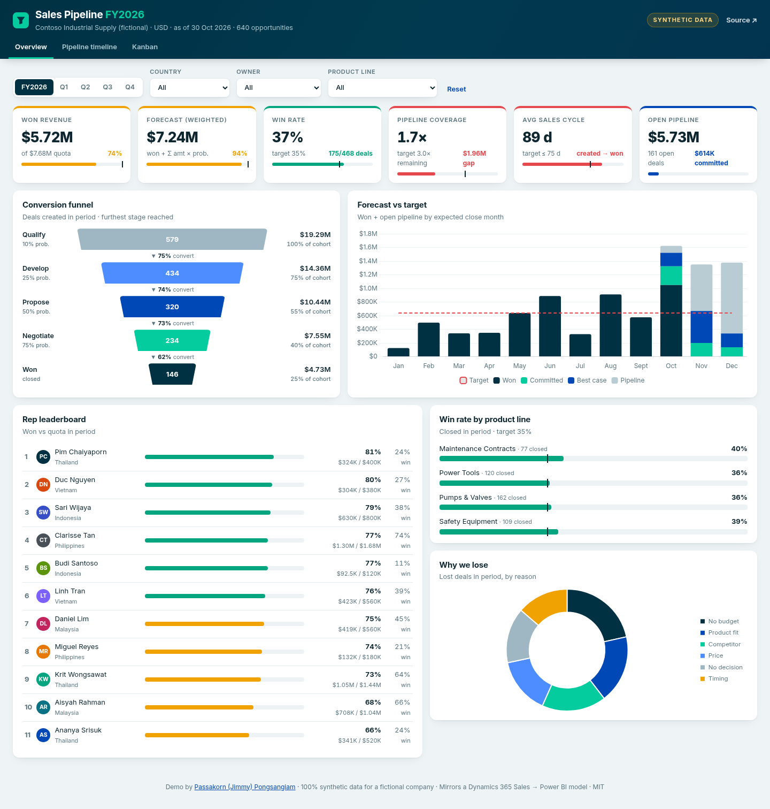
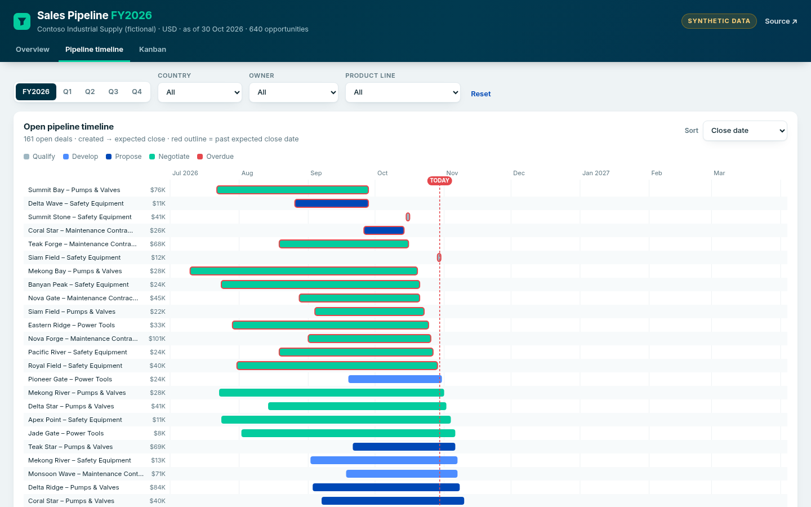
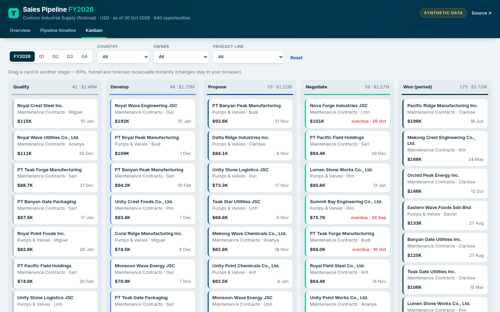
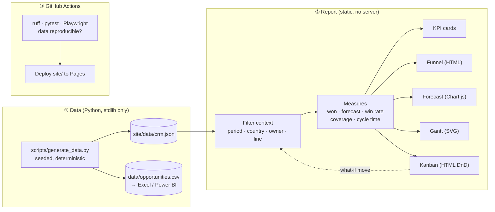

<div align="center">

# 📊 CRM Pipeline Dashboard

**Sales-pipeline analytics built the way a Power BI report is built (KPI scorecard, funnel, forecast vs target, timeline and Kanban), shipped as one static web page.**

[](https://jump1852-code.github.io/crm-pipeline-dashboard/)

[](https://github.com/jump1852-code/crm-pipeline-dashboard/actions/workflows/ci.yml)
[](https://github.com/jump1852-code/crm-pipeline-dashboard/actions/workflows/pages.yml)




</div>

> [!IMPORTANT]
> **All data is synthetic.** "Contoso Industrial Supply" is fictional. Every account, rep and deal is generated by
> [`scripts/generate_data.py`](scripts/generate_data.py) from word lists and random distributions (seed `2026`).
> None of it comes from a real company or CRM.

## Why this exists

Sales leaders ask the same questions every Monday. *Will we hit the quarter? Where are deals getting stuck? Who
needs help?* Answering them well takes more than charts. You need a clean data model, measures that mean the same
thing everywhere, and visuals that respond to the filters the user picks.

This repo shows that end to end, with no licence or login needed:

| Page | What it answers | Visuals |
|---|---|---|
| **Overview** | Are we on target? | 6-card **KPI scorecard vs targets** with RAG colouring and bullet bars · **conversion funnel** with stage-to-stage % · **forecast vs target** by month (Won / Committed / Best case / Pipeline) · **rep leaderboard** (attainment and win rate) · **win rate by product line** vs target · **loss reasons** |
| **Pipeline timeline** | What is closing when, and what has slipped? | Custom SVG **Gantt** of every open deal from created to expected close, with a *today* line and overdue deals outlined. Sortable by close date, amount or age, with hover details |
| **Kanban** | What is in each stage right now? | Stage columns with count and value. **Drag a card** to another stage (or to Won) and every KPI, the funnel and the forecast recalculate instantly, all in the browser |

**Slicers:** period (FY / Q1–Q4) · country (region) · owner (rep) · product line. Country cascades into owner,
just like a Power BI hierarchy slicer.

<table>
<tr>
<td width="50%"></td>
<td width="50%"></td>
</tr>
<tr><td align="center"><sub>Pipeline timeline: overdue deals outlined in red</sub></td><td align="center"><sub>Kanban: drag and drop recalculates the KPIs</sub></td></tr>
</table>

## Architecture



Every visual is a pure function of **(filtered rows → measure → render)**. That is the same evaluation model as
DAX measures over a filter context, so the logic carries straight over to a real Power BI model.

## How it mirrors Power BI / Dynamics 365

The generator writes rows shaped like the Dynamics 365 Sales **Opportunity** table, and the dashboard computes
what a Power BI semantic model on top of Dataverse would compute.

<details open>
<summary><b>Field mapping: Dataverse ↔ this repo</b></summary>

| Dataverse (Opportunity) | This dataset | Notes |
|---|---|---|
| `opportunityid` / `name` | `id`, `name` | |
| `parentaccountid` | `account`, `industry`, `country` | Account dimension |
| `ownerid` | `owner` | Rep dimension; quotas live in a separate **targets** table (owner × quarter) |
| `stepname` / `salesstage` | `stage` | Qualify → Develop → Propose → Negotiate (the default D365 *Opportunity Sales Process*) |
| `statecode` | `status` | Open / Won / Lost |
| `estimatedvalue` / `actualvalue` | `amount` | |
| `closeprobability` | `probability` | Defaults by stage (10 / 25 / 50 / 75 %) with per-deal variation |
| `msdyn_forecastcategory` | `forecast_category` | Pipeline / Best case / Committed / Won / Omitted |
| `createdon`, `estimatedclosedate`, `actualclosedate` | `created_on`, `est_close_date`, `actual_close_date` | |
| Close-as-lost reason | `loss_reason`, `lost_at_stage` | `lost_at_stage` makes a true conversion funnel possible |

</details>

<details>
<summary><b>Measures: JavaScript ↔ DAX equivalents</b></summary>

```DAX
Won Revenue      = CALCULATE ( SUM ( Opp[amount] ), Opp[status] = "Won",
                       USERELATIONSHIP ( Opp[actual_close_date], 'Date'[Date] ) )
Quota            = SUM ( Targets[quota] )
Attainment %     = DIVIDE ( [Won Revenue], [Quota] )
Win Rate         = DIVIDE ( CALCULATE ( COUNTROWS ( Opp ), Opp[status] = "Won" ),
                            CALCULATE ( COUNTROWS ( Opp ), Opp[status] <> "Open" ) )
Weighted Pipe    = SUMX ( FILTER ( Opp, Opp[status] = "Open" ), Opp[amount] * Opp[probability] / 100 )
Forecast         = [Won Revenue] + [Weighted Pipe]
Coverage         = DIVIDE ( [Open Pipeline in Period], [Quota] - [Won Revenue] )
Avg Cycle (days) = AVERAGEX ( FILTER ( Opp, Opp[status] = "Won" ),
                              DATEDIFF ( Opp[created_on], Opp[actual_close_date], DAY ) )
```

The matching JavaScript lives in `measures()` in [`site/app.js`](site/app.js). Each line is a reduce over the
filtered rows.
</details>

<details>
<summary><b>Using it inside Power BI</b></summary>

* **Import the data:** *Get data → Text/CSV →* `data/opportunities.csv`. Add a Date table and a Targets table, and
  the measures above work unchanged.
* **Embed the visuals:** the funnel, Gantt and Kanban are plain HTML/SVG strings. They can be produced by a DAX
  measure and rendered with the *HTML Content* custom visual, or ported to a Power BI custom visual (`pbiviz`)
  with the same render functions.
* **Write back:** the Kanban drag-and-drop is a what-if in the browser. In production the same gesture would call
  a Power Automate flow or the Dataverse Web API to update `salesstage`.

</details>

## Quick start

```bash
git clone https://github.com/jump1852-code/crm-pipeline-dashboard.git
cd crm-pipeline-dashboard
python -m http.server -d site 8000          # → http://localhost:8000
```

Regenerate the data with different assumptions:

```bash
python scripts/generate_data.py --seed 7 --n 900 --as-of 2026-06-30
```

Run the tests (the Playwright browser tests skip themselves if no browser is installed):

```bash
pip install -r requirements-dev.txt playwright && python -m playwright install chromium
pytest -v        # 10 generator tests + 4 browser smoke tests
```

## Data generator, briefly

* 640 opportunities across 5 countries, 11 reps, 4 product lines, Sep 2025 → Oct 2026.
* Deal sizes are **log-normal** per product line. Each deal walks the stages with a per-stage advance probability
  scaled by a hidden rep "skill", so win rates differ by rep the way they do in real life.
* About 8 % of open deals have slipped past their expected close date, so the overdue logic has something to show.
* Quotas are set the way sales ops sets them: from each rep's run-rate plus a 0–30 % stretch.
* Deterministic: the same seed always gives the same file. CI regenerates the data and fails if the committed
  copy drifts.

## Project layout

```
├── scripts/generate_data.py   # synthetic D365-style data (stdlib only)
├── data/opportunities.csv     # flat export for Excel / Power BI
├── site/                      # the whole dashboard: index.html · styles.css · app.js · data/crm.json
├── tests/                     # pytest: generator invariants + Playwright smoke tests
├── docs/                      # screenshots
└── .github/workflows/         # ci.yml · pages.yml
```

## Design notes

* **No framework, no build.** One HTML file, one CSS file and about 400 lines of JS. It loads instantly and runs
  anywhere.
* **Power BI look:** a light report canvas, card visuals with soft shadows, slicers along the top and report
  pages as tabs.
* **Accessible:** real `<select>` slicers, ARIA tabs, visible focus rings and `prefers-reduced-motion` support. It
  is responsive down to 360 px (see [`docs/mobile.png`](docs/mobile.png)).

---

<sub>Built by <a href="https://jump1852-code.github.io/">Passakorn (Jimmy) Pongsangiam</a>, a business analyst who
builds the dashboards he specifies. MIT licensed.</sub>
